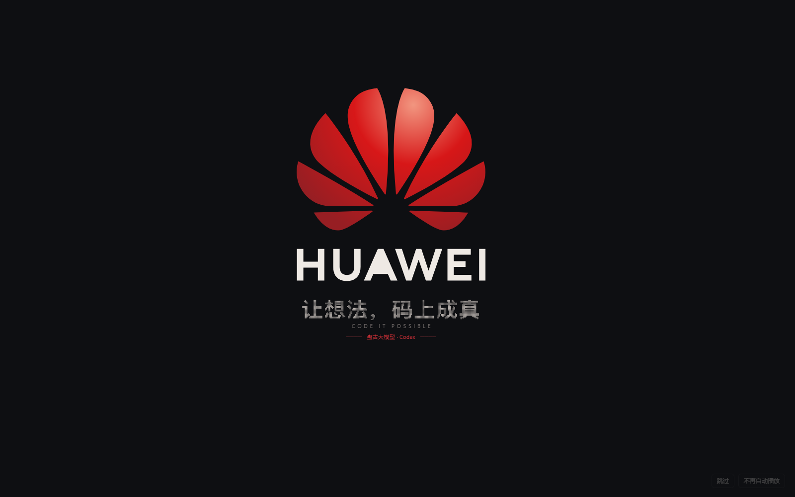

# 盘古 · 桌面开屏动画（DeepSeek Harness / Codex）

把 [pangu-cli-theme](https://github.com/Lightly20110815/pangu-cli-theme) 的华为风格开屏动画，**移植到两个独立桌面应用**上，并在应用里提供开关。

> **这是移植项目，不是原创。** 动画设计、华为花瓣与 HUAWEI 字标的几何数据、渐变参数、像素标语位图都来自上游 [pangu-cli-theme](https://github.com/Lightly20110815/pangu-cli-theme)（MIT，Copyright © 2026 Lightly20110815）。上游只支持**终端里**的 Codex CLI / Claude Code；本项目把同一套视觉搬到桌面 App，重写了渲染与接入层。复用了哪些、新写了哪些，逐条列在 [NOTICE.md](NOTICE.md)。

| 目标 | 接入方式 | 是否改动应用文件 |
|---|---|---|
| **DeepSeek Harness 桌面版** | 客户端插件（`dsh.client` 模块），挂到 profile | 否，应用升级不丢 |
| **Codex / ChatGPT 桌面版**（Windows 商店包） | 启动器 + Chromium 调试端口（CDP）注入 | 否，安装目录零改动 |

## 效果

启动应用 → 红色光标闪两下 → 代码字符收拢 → 八片花瓣由内到外展开（边缘闪着代码字符）→ HUAWEI 字标从左到右「解码」→ 一道光扫过 → 标语、副标语、平台行淡入 → 整层淡出，交还界面。约 3.3 秒。



- `Esc` / `空格` / 双击 可跳过；右下角有「跳过」「不再自动播放」。
- 动画结束后左下角留一个半透明小花（可拖动、位置记忆），点开就是总开关。

## 安装

需要 Node 18+（仅安装脚本用到；应用侧不需要）。

### DeepSeek Harness

```bash
node install-dsh.mjs
```

它会：给**所有 app 型 profile**（`dsh.profile.bundles` 里含 `@deepseek-ai/dsh-web-app`）在 `node_modules` 下建一个指向 `dsh/` 的目录联接，并在各 profile 的 `cordis.patch.yml` 追加一段带标记的挂载段（原文件备份为 `.pangu-bak`）。

然后**完全退出** DeepSeek Harness（托盘图标也要退），再启动。

```bash
node install-dsh.mjs --profile desktop   # 只装指定 profile
node install-dsh.mjs --uninstall         # 卸载
node check-dsh.mjs                       # 自检：挂载 / 组合树 / 真实加载记录
```

### Codex / ChatGPT 桌面版

```bash
node install-codex.mjs
```

会在桌面和开始菜单创建「盘古 · Codex」快捷方式（无控制台窗口）。

> ⚠️ 必须**从这个快捷方式**打开应用才有动画：注入依赖 Chromium 的调试端口，而它是启动参数。从原图标启动 = 原版。
>
> 打开前需完全退出 ChatGPT（含托盘图标）；应用已在运行时启动器会提示先退出。

卸载：`node install-codex.mjs --uninstall`

## 开关

| 位置 | 作用 |
|---|---|
| 开屏右下角「跳过」 | 本次立即结束 |
| 开屏右下角「不再自动播放」 | 立刻关闭总开关 |
| 常驻小花（DSH 默认左下、Codex 默认右下） | **总开关** /「每次启动都播放」/「立即播放一次」 |

小花可拖动，位置记在 `localStorage`；开屏播放期间自动隐藏。

配置落点：

- DSH：`~/.dsh/data/pangu-theme/config.json`（`enabled`、`everyLaunch`）
- Codex：应用 `localStorage` 的 `pangu-theme.config`

## 原理

**DSH**：插件分两半。Node 端只提供 `/pangu-theme/config` 读写路由；浏览器端是一个 `__ModuleLoader__` 模块，DOM 就绪后创建全屏 canvas 播放动画并挂载小花入口。

**Codex**：商店包在 `C:\Program Files\WindowsApps`，只读且有签名，不能改。启动器以 `--remote-debugging-port` 启动 `ChatGPT.exe`，连上 CDP 后：

1. `Page.addScriptToEvaluateOnNewDocument` —— 之后每次页面加载都在文档开始前注入；
2. `Runtime.evaluate` —— 当前文档立刻注入一次。

注入脚本自渲染一个 `position:fixed` 的全屏 canvas，与 DSH 共用同一套引擎。

**共用渲染核心**：

- `shared/art.data.js`：从上游 `art.json` 提取的花瓣/字标多边形、包围盒、径向渐变、像素标语位图（`build/gen-art.mjs` 生成）
- `shared/engine.js`：时间轴 + Canvas 绘制（光标、粒子、花瓣开合、字标解码、光扫、字幕、跳过/淡出）
- `shared/ui.js`：常驻小花入口、开关面板、深浅色跟随、拖动与位置记忆、30 秒冷静期（刷新不重播）

## 目录

```
shared/            两端共用的渲染与 UI
dsh/               DSH 插件包（package.json + cordis.patch.yml + lib/）
codex/             Codex 启动器与注入产物（launcher.mjs / dist/inject.js）
build/             构建、几何提取、预览页、自测页
install-dsh.mjs    安装到 DSH profile
install-codex.mjs  创建 Codex 快捷方式
check-dsh.mjs      DSH 侧自检
```

改完 `shared/` 里的源码后重新生成两份产物：

```bash
node build/build.mjs
```

## 开发与自测

```bash
node build/gen-art.mjs        # 从上游 art.json 重新提取几何（需要 ../pangu 仓库）
node build/build.mjs          # 生成 dsh/lib/client.js 与 codex/dist/inject.js
node build/test-node-half.mjs # DSH Node 端路由单测（假宿主）
node check-dsh.mjs            # DSH 安装状态自检
```

预览某一帧（浏览器打开 `build/preview.html`）：

```
build/preview.html?t=760&brand=codex
build/preview.html?t=2860&brand=dsh
build/selftest-dsh.html?ui=1     # 验证 DSH bundle 的入口与面板
build/selftest-codex.html?ui=1   # 验证 Codex 入口与面板
```

## 已知限制

- **Codex 必须走「盘古 · Codex」快捷方式**；原图标启动没有动画，也看不到开关。
- Codex 的界面是本地 `app://` 壳 + 内嵌 webview；注入目标必须选主窗口 `app://-/index.html`（`detached-window`、沙箱 webview 会被排除），否则动画会打在一个看不见的窗口里。
- 注入发生在页面加载完成之后，Codex 的动画起始比 DSH 晚约 1 秒（第一帧光标可能看不到）。
- 窗口在后台时 Chromium 会把 `requestAnimationFrame` 节流到 ~1fps，动画看起来像卡住；切到前台恢复。
- DSH 的 Node 端必须声明 `inject: ['webServer']`：否则插件会在 webServer 注册前加载，路由静默注册失败。
- DSH 装错 profile 完全无感（补丁段在、组合树里也有，但应用不启动那个 profile）；`desktop` profile 由 Electron 独占，CLI 无法 `--dump-config` 校验。
- 商店包升级后安装目录会变成新版本号；启动器从注册表 `PackageRootFolder` 读路径，无需改配置。
- 在 Windows 11 + DeepSeek Harness 0.2.1-rc.2 / ChatGPT 桌面版 26.1007 上验证；其他版本未测。

## 许可

代码以 MIT 发布（Copyright © 2026 panan），**包含上游 MIT 许可**，见 [LICENSE](LICENSE)。

`HUAWEI`、华为花瓣标志与 HUAWEI 字标是华为技术有限公司的商标，**不在 MIT 许可范围内**。本项目是非官方爱好者作品，与华为、OpenAI、DeepSeek 均无关系。
